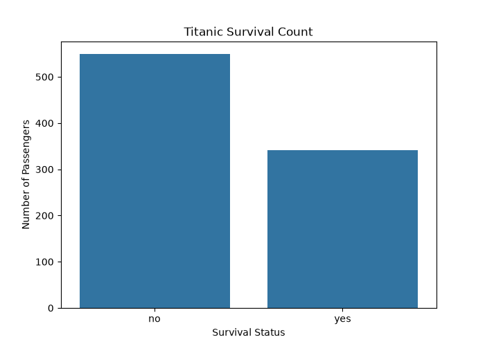
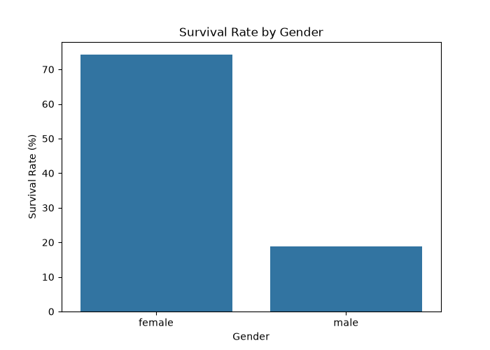
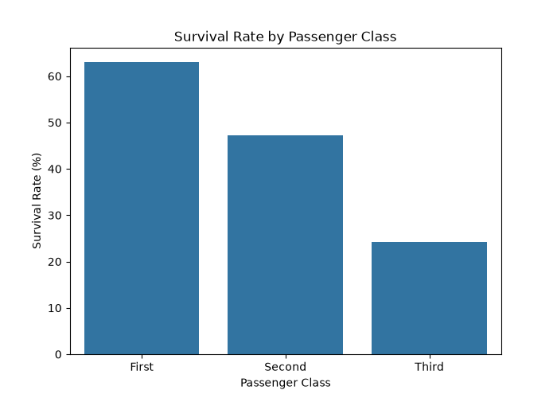
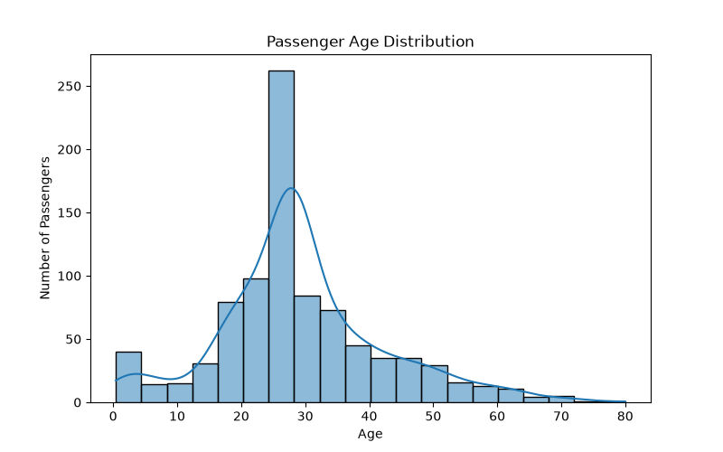
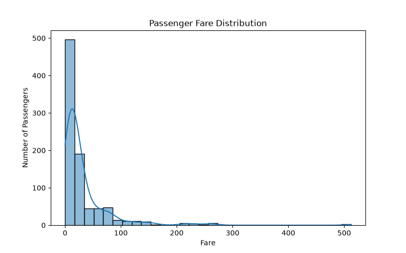

# Titanic Exploratory Data Analysis (EDA)

## Project Overview
This project performs Exploratory Data Analysis (EDA) on the Titanic dataset using Python.

The main objective is to understand passenger survival patterns, analyze trends, and identify useful insights through data analysis and visualization.

## Tools & Technologies
- Python
- Pandas
- NumPy
- Matplotlib
- Seaborn
- VS Code

## Dataset Information
- Total Rows: 891
- Total Columns: 15
- Dataset: Titanic Cleaned Dataset

## Analysis Performed
- Dataset overview
- Statistical summary
- Missing values analysis
- Duplicate records analysis
- Survival count analysis
- Gender-wise survival analysis
- Passenger class analysis
- Age group analysis

## Data Visualizations

### 1. Survival Count

### 2. Survival Rate by Gender

### 3. Survival Rate by Passenger Class

### 4. Age Distribution

### 5. Fare Distribution

## Key Insights

1. Out of 891 passengers, 342 (38.38%) survived.
2. Female survival rate was 74.20%, compared to 18.89% for males.
3. First Class had the highest survival rate at 62.96%.
4. Children had a survival rate of 57.97%, while seniors had 22.73%.
5. The Deck column had 688 missing values (77.22%).

## Conclusion
The analysis shows that survival rates varied significantly by gender, passenger class, and age group.

Python visualization libraries helped identify important patterns in the Titanic dataset.

## Author
Kunal Shinde

GitHub: https://github.com/kunalshinde2109